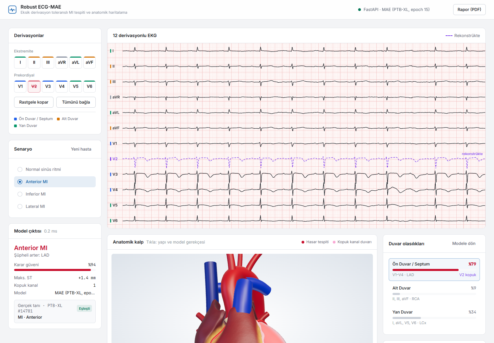
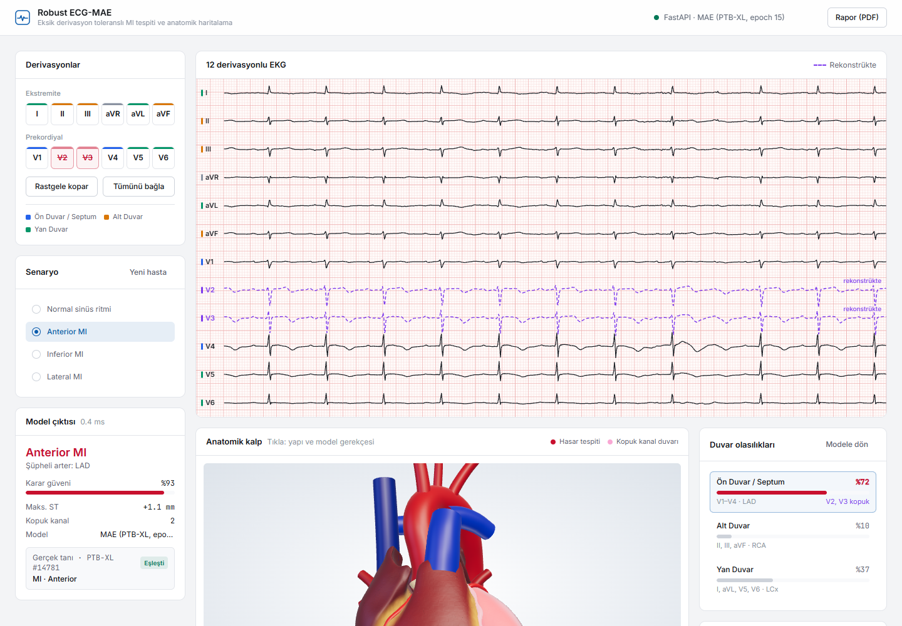
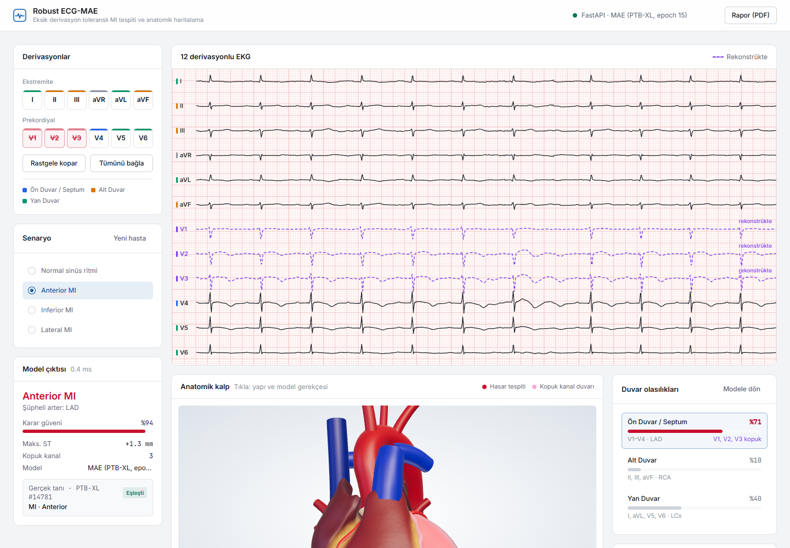
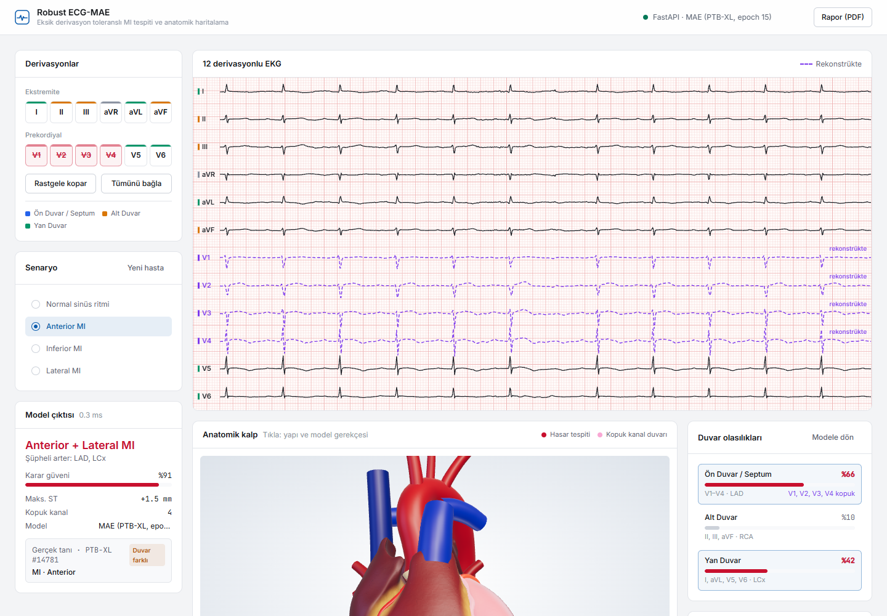
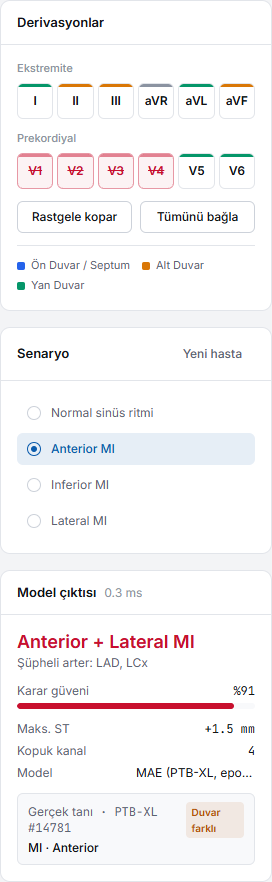
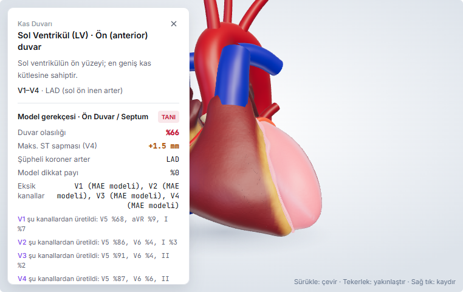

# İP5 Canlı Stres Testi: Kasti Derivasyon Kopması

Raporun İP5 başarı ölçütü: "1, 2, 3 ve 4 kanal kasti koparma stres testlerinin canlı doğrulanması". Bu belge, eğitilmiş MAE'ye bağlı arayüzde yapılan canlı testi ekran görüntüleriyle kaydeder.

## Koşullar

| | |
|---|---|
| Tarih | 18.10.2026 |
| Model | `models/mae_ecg_checkpoint.pth` (15 epoch), kalibre duvar eşikleri (`models/wall_thresholds.json`) |
| Veri | PTB-XL test seti (strat_fold 10, eğitimde görülmedi), repodaki demo alt kümesi |
| Backend | `python -m uvicorn src.main:app` (CPU) |
| Arayüz | #5 ve #6 numaralı PR'lardaki sürüm (çoklu duvar, gerçek tanı, rekonstrüksiyon kaynakları, Yeni hasta) |
| Ekran görüntüleri | 1440×1000, headless Chrome. FPS rozeti gizlendi; headless tarayıcıda çizim kısıldığı için değeri anlamsız |

Kopan kanal arayüzde **0 V** olarak gelir (kablo kopması). Mor kesikli çizgi o kanalın rekonstrüksiyonudur: göğüs derivasyonlarında MAE, ekstremite derivasyonlarında Einthoven bağıntıları.

## Canlı test: kayıt #14781 (gerçek tanı: Anterior MI)

Kopmalar ön duvar derivasyonlarından seçildi; yani her adımda modelin teşhis koyduğu duvarın kendi kanalları kayboluyor. En zor durum, V1–V4'ün dördü birden koptuğu **kritik Anterior** senaryosu.

| Adım | Kopuk kanal | Model teşhisi | Güven | Gerçek tanı | Sonuç |
|---|---|---|---|---|---|
| 0 | — | Anterior MI | %95 | Anterior MI | ✅ |
| 1 | V2 | Anterior MI | %94 | Anterior MI | ✅ |
| 2 | V2, V3 | Anterior MI | %93 | Anterior MI | ✅ |
| 3 | V1, V2, V3 | Anterior MI | %94 | Anterior MI | ✅ |
| 4 | V1–V4 (kritik) | Anterior + Lateral MI | %91 | Anterior MI | ⚠️ MI doğru, fazladan Lateral |

**0 kopuk kanal**


**1 kopuk kanal (V2)**


**2 kopuk kanal (V2, V3)**


**3 kopuk kanal (V1, V2, V3)**


**4 kopuk kanal: kritik Anterior (V1–V4)**


Kritik senaryoda model çıktısı ve 3D kalp, Click-to-Explain kartıyla:

| | |
|---|---|
|  |  |

Kartta, kopan her kanalın hangi sağlam kanallardan üretildiği görülüyor (Md. 2.3). V1–V4'ün dördü de ağırlıklı olarak **V5**'ten üretiliyor (%68–91). Ön duvarın "Model dikkat payı" %0, çünkü o duvarın bütün kanalları kopuk ve dikkat yalnızca sağlam kanallara dağılıyor.

## Kritik duvar kopmaları: üç kayıt

Aynı ölçüm, her duvarın tüm kanallarının koptuğu senaryolarda ve farklı gerçek tanılarda tekrarlandı. Değerler `GET /api/sample-ecg?ecg_id=…&dropped=…` ile alındı; aynı kayıt ve kopma için sonuç deterministiktir.

| Kayıt (gerçek tanı) | Kopuk yok | 4 kanal: V1–V4 | 3 kanal: II, III, aVF | 4 kanal: I, aVL, V5, V6 |
|---|---|---|---|---|
| #14781 (Anterior) | Anterior %95 ✅ | Anterior + Lateral %91 ⚠️ | Anterior %96 ✅ | Anterior %92 ✅ |
| #14424 (Inferior) | Inferior %87 ✅ | Inferior %91 ✅ | Inferior %85 ✅ | Inferior %85 ✅ |
| #17658 (Anterior + Lateral) | Anterior + Lateral %73 ✅ | Anterior + Lateral %66 ✅ | Anterior %74 ⚠️ | Anterior + Lateral %70 ✅ |

- II, III, aVF koptuğunda bu üç kanal Einthoven bağıntılarıyla **kesin** hesaplanıyor (Risk 1 B planı). I ve aVL koptuğunda da aynısı geçerli. V5 ve V6 ise MAE ile üretiliyor.
- #14424'te Inferior MI, alt duvarın üç kanalı da koptuğu hâlde %85 güvenle bulundu.
- #17658'in güveni %66–74 arasında; arayüz bu kayıtta "karar sınırda" uyarısını gösteriyor.

## Değerlendirme

1. **MI tespiti 21 denemenin 21'inde korundu.** 3 kayıt × 7 senaryo, 1–4 kanal kopması dahil; hiçbir kopma MI'ı kaçırtmadı. Bu, raporun hipotezindeki yanlış negatif azaltma iddiasıyla tutarlı. Tüm test setindeki sayısal sonuçlar `docs/SONUCLAR.md` dosyasında.
2. **Duvar ayrımı en zor senaryoda kayıyor.**
   - #14781'de V1–V4 koptuğunda model fazladan Lateral dedi. Ön duvarın tüm bilgisi V5'ten geldiği için yan duvarla karışıyor.
   - #17658'de alt duvar kanalları koptuğunda Lateral düştü.
   - Bu, test setindeki bulguyla aynı yönde: kritik Anterior'da R² 0.49, kriz tipi AUROC 0.90.
3. **Arayüz her adımda tutarlı.** Kopuk kanallar pembe yanıp sönüyor ve mor rekonstrüksiyonla gösteriliyor. Hasar tespit edilen duvarlar kırmızı, gerçek tanı rozeti tahminle karşılaştırılıyor.
4. **Çıkarım süresi** bu testte CPU'da 49–152 ms arasında (Intel dizüstü). M3 GPU'da 13–22 ms; ayrıntı `docs/SONUCLAR.md` içinde.

## Yeniden üretme

1. Backend'i ve arayüzü başlat:
   ```bash
   python -m uvicorn src.main:app --port 8000
   ```
   ```bash
   npm run dev
   ```
2. Arayüzde senaryoyu seç ve kanalları sırayla kopar. Senaryodaki kayıt rastgele seçildiği için gösterilen kayıt farklı olabilir; "Yeni hasta" ile değiştirilebilir.
3. Belirli bir kaydı arayüz durumunu değiştirmeden analiz etmek için:
   ```bash
   curl "http://localhost:8000/api/sample-ecg?ecg_id=14781&dropped=V1,V2,V3,V4"
   ```
